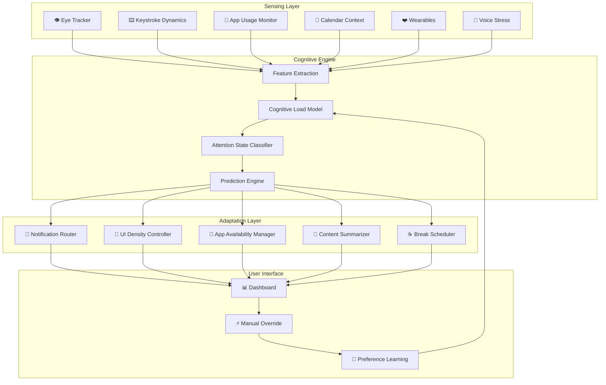

# 🧠 CogniPace

> **Your Cognitive Load & Attention Operating System**

CogniPace is an open-source, local-first system that continuously measures your cognitive state and dynamically adapts your digital environment to match your mental capacity—reducing burnout, improving focus, and making technology serve human limits rather than ignoring them.

[](LICENSE)
[](STATUS)
[](docs/PLATFORMS.md)
[](https://www.python.org/downloads/)
[](https://www.rust-lang.org/)

---

## 📋 Table of Contents

- [Vision](#-vision)
- [The Problem](#-the-problem)
- [The Solution](#-the-solution)
- [Architecture](#-architecture)
- [Core Components](#-core-components)
- [Cognitive Load Model](#-cognitive-load-model)
- [Attention States](#-attention-states)
- [Adaptation Mechanisms](#-adaptation-mechanisms)
- [Privacy & Ethics](#-privacy--ethics)
- [Tech Stack](#-tech-stack)
- [Competitive Landscape](#-competitive-landscape)
- [Roadmap](#-roadmap)
- [Getting Started](#-getting-started)
- [Contributing](#-contributing)
- [Research & References](#-research--references)
- [License](#-license)

---

## 🎯 Vision

Technology today demands more attention than humans can give. We're drowning in notifications, context switches, and information overload. CogniPace envisions a future where your computer **understands your mental state** and **adapts to you**—not the other way around.

**Core Philosophy**: Technology should respect human cognitive limits.

---

## ⚠️ The Problem

### The Attention Crisis
- The average knowledge worker switches tasks **every 3 minutes**
- It takes **23 minutes** to refocus after an interruption
- **86%** of workers report feeling overwhelmed by digital distractions
- Burnout costs the global economy **$322 billion** annually

### Current Solutions Fall Short

| Solution Type | Examples | Why They Fail |
|--------------|----------|---------------|
| **Time Trackers** | RescueTime, Toggl | Measure but don't adapt |
| **Blockers** | Freedom, Cold Turkey | Static rules, no context awareness |
| **Focus Timers** | Pomodoro apps | One-size-fits-all timing |
| **Wellness Apps** | Calm, Headspace | Separate from work environment |
| **Screen Time** | Apple/Google built-in | Parental control focus, no intelligence |

**The Gap**: No system **closes the loop** between sensing cognitive state and adapting the digital environment in real-time.

---

## 💡 The Solution

CogniPace is the first **closed-loop cognitive adaptation system** for personal computing:

```
┌─────────────────────────────────────────────────────────────┐
│                     COGNIPACE LOOP                          │
│                                                             │
│   ┌──────────┐    ┌──────────┐    ┌──────────┐             │
│   │  SENSE   │───▶│  THINK   │───▶│  ADAPT   │             │
│   │          │    │          │    │          │             │
│   │ • Eyes   │    │ • Load   │    │ • Notify │             │
│   │ • Keys   │    │ • State  │    │ • UI     │             │
│   │ • Apps   │    │ • Predict│    │ • Apps   │             │
│   │ • Body   │    │          │    │ • Break  │             │
│   └──────────┘    └──────────┘    └──────────┘             │
│        ▲                                    │               │
│        └────────────────────────────────────┘               │
│                     Feedback Loop                           │
└─────────────────────────────────────────────────────────────┘
```

### Key Innovations

1. **Real-Time Cognitive Sensing**: Uses webcam, keyboard, and app usage to measure mental load
2. **Adaptive Intelligence**: ML model learns your personal patterns and predicts overload
3. **Dynamic Environment Adaptation**: Automatically adjusts notifications, UI complexity, and app availability
4. **100% Local Processing**: No data leaves your machine—privacy by design
5. **Cross-Platform**: Works on Linux, macOS, and Windows

---

## 🏗️ Architecture

### System Overview



### Data Flow

```
Raw Sensor Data → Feature Extraction → Cognitive Model → Adaptation Decision → User Feedback → Model Update
     (ephemeral)      (local only)       (on-device)        (real-time)        (dashboard)     (continuous)
```

---

## 🔧 Core Components

### 1. Sensing Layer

#### Primary Sensors (High Signal-to-Noise)

| Sensor | Technology | Measures | Privacy Risk |
|--------|-----------|----------|--------------|
| **Gaze Tracking** | MediaPipe Face Mesh | Focus drift, reading speed, attention target | 🔴 High |
| **Keystroke Dynamics** | OS-level hooks (evdev, CGEvent, Win32) | Typing speed, error rate, hesitation | 🟡 Medium |
| **App Switching Rate** | Window manager API | Task fragmentation, context switching | 🟢 Low |
| **Calendar Context** | Calendar API integration | Meeting density, deadline proximity | 🟡 Medium |

#### Secondary Sensors (Enrichment)

| Sensor | Technology | Measures | Privacy Risk |
|--------|-----------|----------|--------------|
| **Heart Rate Variability** | Bluetooth LE (Apple Health, Google Fit) | Stress level, recovery state | 🔴 High |
| **Voice Stress** | Microphone + Librosa | Vocal tension, fatigue | 🔴 High |
| **Posture Detection** | Webcam + Pose estimation | Physical fatigue, engagement | 🔴 High |
| **Time of Day** | System clock | Circadian rhythm effects | 🟢 None |

#### Privacy-First Sensor Design

```
┌─────────────────────────────────────────────────────┐
│                  PRIVACY PIPELINE                   │
│                                                     │
│  Raw Frames    ──▶  Features Only  ──▶  Model      │
│  (deleted)         (gaze_variance)     (inference)  │
│                                                     │
│  🔴 NEVER STORED    🟢 ANONYMIZED     🟢 LOCAL      │
└─────────────────────────────────────────────────────┘
```

**Guarantees**:
- Raw sensor data is processed in memory and immediately discarded
- Only derived feature vectors (e.g., `gaze_variance: 0.23`) are stored
- All processing happens on-device—zero network calls for sensor data
- Clear system indicator when camera/microphone is active

---

### 2. Cognitive Engine

#### Cognitive Load Theory Foundation

Based on **Sweller's Cognitive Load Theory** (1988), adapted for digital environments:

```
                    COGNITIVE LOAD
                         │
        ┌────────────────┼────────────────┐
        │                │                │
   INTRINSIC       EXTRANEous       GERMANE
        │                │                │
   Task complexity  UI clutter       Schema
   Prior knowledge  Notifications    building
   Domain expertise Context switches Pattern recog.
```

#### Load Score Calculation

```python
cognitive_load_score = (
    intrinsic_load * 0.3 +      # Task complexity (from app context)
    extraneous_load * 0.5 +     # Environmental factors (notifications, UI)
    physiological_load * 0.2    # Body signals (HRV, posture, fatigue)
)
```

#### Attention State Classifier

The system classifies your current state into one of six categories:

| State | Indicators | System Response |
|-------|-----------|-----------------|
| 🟢 **Deep Focus** | Stable gaze, low app switching, fast typing | Block all notifications, simplify UI |
| 🟡 **Flow Building** | Increasing focus metrics, single app usage | Gradually reduce interruptions |
| 🟠 **Fragmented** | High app switching, gaze drift, errors | Suggest break, batch notifications |
| 🔴 **Fatigued** | Slow typing, posture slump, HRV drop | Enforce break, reduce complexity |
| ⚫ **Overloaded** | All signals elevated, rapid context switches | Emergency simplification mode |
| 🔵 **Recovering** | Improving metrics post-break | Gradual re-introduction of stimuli |

#### ML Pipeline Architecture

```python
class CognitiveLoadModel:
    """
    Multi-modal cognitive load prediction model.
    
    Processes sensor streams through temporal encoding
    to predict current cognitive state and forecast future load.
    """
    
    def __init__(self):
        self.feature_extractor = MultiModalFeatureExtractor()
        self.temporal_encoder = TransformerEncoder(window_size=300)  # 5-min windows
        self.classifier = AttentionStateClassifier()
        self.predictor = LoadPredictor(horizon=900)  # 15-min predictions
        self.personalizer = UserAdaptationLayer()

    def predict(self, sensor_stream: SensorData) -> Tuple[State, Forecast]:
        features = self.feature_extractor.extract(sensor_stream)
        context = self.temporal_encoder.encode(features)
        current_state = self.classifier.predict(context)
        future_load = self.predictor.forecast(context)
        personalized = self.personalizer.adapt(current_state, future_load)
        return personalized
```

---

### 3. Adaptation Layer

#### Notification Router

```
┌─────────────────────────────────────────────────────┐
│              NOTIFICATION ROUTING                   │
│                                                     │
│  Incoming ──▶  Cognitive State?                     │
│  Notification      │                                │
│                    ├── Deep Focus  → Queue          │
│                    ├── Fragmented  → Batch & Summarize│
│                    ├── Fatigued    → Block Non-Urgent│
│                    ├── Overloaded  → Block All      │
│                    └── Recovering  → Priority Only  │
│                                                     │
│  Queued/Batched ──▶  Delivery Window ──▶  User     │
└─────────────────────────────────────────────────────┘
```

**Smart Prioritization**:
- Urgency detection from notification content
- Sender relationship learning (boss vs. newsletter)
- Time-sensitive vs. deferrable classification
- Batch delivery during low-load periods

#### UI Density Controller

Adapts interface complexity based on cognitive capacity:

| Load Level | UI Adaptation | Example |
|------------|---------------|---------|
| 🟢 Low (fresh) | Full detail, rich visualizations, advanced options | Complete dashboard with all metrics |
| 🟡 Medium | Standard view, key information highlighted | Main metrics, secondary collapsed |
| 🟠 High (stressed) | Minimal view, only essential actions, larger text | Top 3 items only |
| 🔴 Critical | Emergency mode: single task, everything else hidden | Current task only |

#### App Availability Manager

```
┌─────────────────────────────────────────────────────┐
│            APP AVAILABILITY MATRIX                  │
│                                                     │
│  High Load Detected:                                │
│  ✅ IDE / Code Editor          → Available          │
│  ✅ Terminal                   → Available          │
│  ✅ Documentation              → Available          │
│  ⚠️  Email Client              → Batch Mode         │
│  ❌ Social Media               → Blocked            │
│  ❌ News Sites                 → Blocked            │
│  ❌ Messaging (non-urgent)     → Queued             │
│                                                     │
│  Low Load Detected:                                 │
│  ✅ All Apps                   → Available          │
│  ✅ Creative Tools             → Unlocked           │
│  ✅ Exploration                → Encouraged         │
└─────────────────────────────────────────────────────┘
```

#### Content Summarizer

- **Email**: Auto-summarizes long threads into key points when load is high
- **Articles**: Generates TL;DR for long-form content during fragmented states
- **Code Reviews**: Highlights only critical changes during fatigue
- **Documents**: Extracts action items and deadlines automatically

Powered by local LLMs (Ollama, Llama.cpp)—no cloud API calls.

#### Break Scheduler

Based on **ultradian rhythm** science (90-minute biological cycles) + real-time signals:

```
┌─────────────────────────────────────────────────────┐
│                 BREAK SCHEDULER                     │
│                                                     │
│  90-min cycle detected ──▶  Check Cognitive State   │
│                              │                      │
│                              ├── Still Focused      │
│                              │   → Soft suggestion  │
│                              │                      │
│                              ├── Declining Metrics  │
│                              │   → Firm suggestion  │
│                              │                      │
│                              └── Already Fatigued   │
│                                  → Enforced break   │
│                                                     │
│  Break Activities:                                  │
│  🚶 Walk  |  🧘 Stretch  |  🫁 Breathe  |  💧 Hydrate│
└─────────────────────────────────────────────────────┘
```

---

## 🔒 Privacy & Ethics

### Privacy by Design

```
┌─────────────────────────────────────────────────────┐
│              PRIVACY GUARANTEES                     │
│                                                     │
│  ✅ All processing happens locally                  │
│  ✅ No raw sensor data is stored                    │
│  ✅ Explicit consent required per sensor            │
│  ✅ Transparent data flow visualization             │
│  ✅ User can export/delete all data anytime         │
│  ✅ Zero telemetry without explicit opt-in          │
│  ✅ Open source—fully auditable                     │
└─────────────────────────────────────────────────────┘
```

### Ethical Guardrails

| Principle | Implementation |
|-----------|----------------|
| **No Manipulation** | System never hides information without user knowledge |
| **No Dark Patterns** | All adaptations are reversible and transparent |
| **User Always in Control** | Manual override available instantly |
| **Explainable AI** | Every decision logged with reasoning |
| **No Behavioral Exploitation** | Never optimized for engagement—only wellbeing |

### Data Lifecycle

```
┌──────────┐    ┌──────────┐    ┌──────────┐    ┌──────────┐
│  Capture │───▶│ Process  │───▶│  Store   │───▶│  Expire  │
│          │    │          │    │          │    │          │
│ Raw data │    │ Features │    │ Vectors  │    │ Auto-    │
│ in RAM   │    │ extracted│    │ only     │    │ delete   │
└──────────┘    └──────────┘    └──────────┘    └──────────┘
   (seconds)       (seconds)       (days)         (configurable)
```

---

## 🛠️ Tech Stack

| Component | Technology | Rationale |
|-----------|-----------|-----------|
| **Core Engine** | Rust | Performance, memory safety, cross-platform |
| **Eye Tracking** | MediaPipe Face Mesh (via C API) | Local, real-time, 468 landmarks |
| **Keystroke Analysis** | Native OS hooks (evdev, CGEvent, Win32) | Low-level access, minimal latency |
| **ML Inference** | ONNX Runtime + ort (Rust bindings) | Local inference, no cloud dependency |
| **Model Training** | Python + PyTorch + scikit-learn | Rich ecosystem, easy experimentation |
| **Database** | SQLite + SQLCipher | Encrypted, embedded, time-series capable |
| **Notification System** | DBus (Linux), UserNotifications (Mac), WinRT (Windows) | Native integration |
| **UI Dashboard** | Tauri (Rust + Svelte frontend) | Lightweight, secure, cross-platform |
| **Browser Extension** | WebExtensions API | Works across Chrome/Firefox/Edge |
| **Wearable Sync** | Bluetooth LE + vendor SDKs | Standard protocol |
| **Local LLM** | Ollama / Llama.cpp | On-device summarization |

### Project Structure

```
cognipace/
├── README.md
├── LICENSE
├── CONTRIBUTING.md
├── CODE_OF_CONDUCT.md
├── docs/
│   ├── ARCHITECTURE.md
│   ├── PRIVACY.md
│   ├── API.md
│   └── RESEARCH.md
├── crates/
│   ├── cognipace-core/          # Core cognitive engine
│   ├── cognipace-sensors/       # Sensor abstraction layer
│   ├── cognipace-adaptations/   # Adaptation mechanisms
│   ├── cognipace-dashboard/     # Tauri-based UI
│   └── cognipace-cli/           # Command-line interface
├── python/
│   ├── models/                  # ML model definitions
│   ├── training/                # Training pipelines
│   └── evaluation/              # Model evaluation scripts
├── extensions/
│   ├── browser/                 # WebExtension
│   └── vscode/                  # VS Code extension
└── configs/
    ├── default.yaml             # Default configuration
    └── profiles/                # Pre-built profiles
```

---

## 📊 Competitive Landscape

### Open Source Solutions

| Project | What It Does | Gap CogniPace Fills |
|---------|-------------|---------------------|
| **ActivityWatch** | Time tracking, app usage monitoring | No cognitive sensing, no adaptation |
| **RescueTime** (proprietary) | Productivity tracking | Cloud-based, no real-time adaptation |
| **Plasma Active** (KDE) | Basic activity monitoring | No ML, no cognitive model |
| **Keylogger tools** | Keystroke logging | No analysis, privacy concerns |
| **Eye tracking libs** | Gaze tracking (various) | No integration with productivity |

### Proprietary Solutions

| Product | What It Does | Why CogniPace Is Different |
|---------|-------------|---------------------------|
| **RescueTime** | Tracks time in apps | No real-time adaptation, no cognitive sensing |
| **Freedom** | Blocks distracting websites | Static rules, no context awareness |
| **Cold Turkey** | Hard blocking of apps | No intelligence, no adaptation |
| **Oura/Whoop** | Tracks recovery/sleep | No digital environment adaptation |
| **Apple Screen Time** | Usage limits | Parental control focus, no cognitive model |
| **Microsoft Viva Insights** | Workplace analytics | Enterprise-focused, cloud-based |

### The CogniPace Advantage

```
┌─────────────────────────────────────────────────────────────┐
│                    COMPETITIVE MOAT                         │
│                                                             │
│  Feature              │ Others │ CogniPace                 │
│  ─────────────────────┼────────┼────────────────────────── │
│  Real-time sensing    │   ❌   │   ✅ (webcam, keys, apps) │
│  Cognitive load model │   ❌   │   ✅ (ML-based)           │
│  Dynamic adaptation   │   ❌   │   ✅ (notifications, UI)  │
│  Local-first          │   ❌   │   ✅ (100% on-device)     │
│  Open source          │   ❌   │   ✅ (MIT License)        │
│  Cross-platform       │   ⚠️   │   ✅ (Linux/Mac/Windows)  │
│  Personalization      │   ❌   │   ✅ (learns over time)   │
│  Predictive           │   ❌   │   ✅ (forecasts overload) │
└─────────────────────────────────────────────────────────────┘
```

---

## 🗺️ Roadmap

### Phase 1: Foundation (Months 1-3)

**Goal**: Core sensing infrastructure and basic cognitive scoring

- [ ] Cross-platform sensor abstraction layer
  - [ ] Linux (evdev, DBus)
  - [ ] macOS (CGEvent, EventKit)
  - [ ] Windows (Win32 API, UWP)
- [ ] Webcam-based eye tracking using MediaPipe
- [ ] Keystroke dynamics collector
- [ ] Basic cognitive load scoring algorithm (rule-based)
- [ ] Local SQLite database for feature storage
- [ ] CLI for viewing current cognitive state

**Deliverable**: `cognipace-cli` showing real-time cognitive load score

### Phase 2: Intelligence (Months 4-6)

**Goal**: ML-powered state classification and prediction

- [ ] Collect training dataset from beta users
- [ ] Train attention state classifier
- [ ] Implement temporal model (LSTM/Transformer)
- [ ] Build prediction engine for load forecasting
- [ ] Personalization layer (user feedback loop)
- [ ] Privacy-preserving data pipeline
- [ ] Model evaluation framework

**Deliverable**: ML model with >80% state classification accuracy

### Phase 3: Adaptation (Months 7-9)

**Goal**: Closed-loop adaptation system

- [ ] Notification routing system
  - [ ] Linux (DBus notifications)
  - [ ] macOS (UserNotifications)
  - [ ] Windows (Toast notifications)
- [ ] UI density controller
  - [ ] Browser extension
  - [ ] Desktop app integration
- [ ] App availability manager
- [ ] Break scheduler with activity suggestions
- [ ] Cognitive dashboard (Tauri-based)
- [ ] Content summarizer (local LLM integration)

**Deliverable**: Full closed-loop system on Linux

### Phase 4: Polish & Scale (Months 10-12)

**Goal**: Production-ready cross-platform release

- [ ] Wearable integration (Apple Health, Google Fit)
- [ ] Cross-device sync (local network only)
- [ ] VS Code / JetBrains extensions
- [ ] Open API for third-party integrations
- [ ] Comprehensive documentation
- [ ] Community building and contributor onboarding
- [ ] Security audit

**Deliverable**: v1.0 release on all platforms

### Future Vision (Year 2+)

- [ ] Multi-user household support
- [ ] Team-level cognitive load awareness
- [ ] Integration with smart home systems
- [ ] Research partnerships with universities
- [ ] Mobile app (iOS/Android)
- [ ] Enterprise wellness features

---

## 🚀 Getting Started

### Prerequisites

- **Rust** 1.70+
- **Python** 3.10+ (for ML training)
- **Webcam** (for eye tracking)
- **Linux** (recommended for development), macOS, or Windows

### Quick Start

```bash
# Clone the repository
git clone https://github.com/your-org/cognipace.git
cd cognipace

# Build the core engine
cargo build --release

# Run the CLI
cargo run --bin cognipace-cli

# Start the dashboard
cargo run --bin cognipace-dashboard
```

### Development Setup

```bash
# Install dependencies
./scripts/setup.sh

# Run tests
cargo test

# Run with all sensors enabled
cargo run --bin cognipace-cli -- --sensors=all

# Train ML models
cd python/training
pip install -r requirements.txt
python train.py
```

### Docker Development

```bash
# Build development container
docker build -t cognipace-dev .

# Run with GPU support (for ML)
docker run --gpus all -it cognipace-dev
```

### Configuration

Create `~/.config/cognipace/config.yaml`:

```yaml
sensors:
  eye_tracking:
    enabled: true
    sample_rate: 30  # Hz
  keystroke:
    enabled: true
  app_usage:
    enabled: true
  calendar:
    enabled: false
    source: "google"  # or "local"
  wearables:
    enabled: false

adaptations:
  notifications:
    enabled: true
    mode: "adaptive"  # or "aggressive", "gentle"
  ui_density:
    enabled: true
  app_blocking:
    enabled: false  # opt-in for safety
  breaks:
    enabled: true
    interval: 90  # minutes
    duration: 5   # minutes

privacy:
  data_retention_days: 7
  telemetry: false
  raw_data_storage: false
```

---

## 🤝 Contributing

We welcome contributions! CogniPace is a complex project spanning multiple domains:

### Areas Where Help Is Needed

| Area | Skills Needed | Priority |
|------|--------------|----------|
| **Rust Development** | Systems programming, async | 🔴 High |
| **ML/AI** | PyTorch, time-series classification | 🔴 High |
| **Platform Integration** | Linux/macOS/Windows APIs | 🟡 Medium |
| **Frontend** | Svelte, Tauri, data visualization | 🟡 Medium |
| **Browser Extensions** | WebExtensions API | 🟡 Medium |
| **Documentation** | Technical writing | 🟢 Ongoing |
| **Testing** | QA, test automation | 🟢 Ongoing |
| **Research** | Cognitive science, HCI | 🟢 Ongoing |

### How to Contribute

1. Read our [Code of Conduct](CODE_OF_CONDUCT.md)
2. Check [open issues](https://github.com/your-org/cognipace/issues) for good first issues
3. Fork the repository and create a feature branch
4. Write tests for your changes
5. Submit a pull request

See [CONTRIBUTING.md](CONTRIBUTING.md) for detailed guidelines.

---

## 📚 Research & References

### Cognitive Load Theory
- Sweller, J. (1988). "Cognitive load during problem solving"
- Paas, F. et al. (2003). "Cognitive load measurement as a means to advance cognitive load theory"

### Attention & Focus
- Mark, G. et al. (2008). "The cost of interrupted work"
- Ophir, E. et al. (2009). "Cognitive control in media multitaskers"

### Keystroke Dynamics
- Banerjee, S.P. & Woodard, D.L. (2012). "Biometric authentication and identification using keystroke dynamics"

### Eye Tracking
- Duchowski, A.T. (2017). "Eye Tracking Methodology: Theory and Practice"

### Ultradian Rhythms
- Kleitman, N. (1963). "Sleep and Wakefulness"
- Rossi, E.L. (1991). "The 20-Minute Break"

---

## 📄 License

This project is licensed under the **MIT License**—see the [LICENSE](LICENSE) file for details.

---

## 🙏 Acknowledgments

- [MediaPipe](https://github.com/google/mediapipe) for eye tracking infrastructure
- [ActivityWatch](https://activitywatch.net/) for inspiration on local-first activity tracking
- The cognitive science research community for foundational theories
- All contributors who believe technology should respect human limits

---

<div align="center">

**CogniPace** — *Technology that respects your mind.*

[📖 Documentation](docs/) · [🐛 Report Bug](https://github.com/your-org/cognipace/issues) · [💡 Request Feature](https://github.com/your-org/cognipace/issues)

</div>